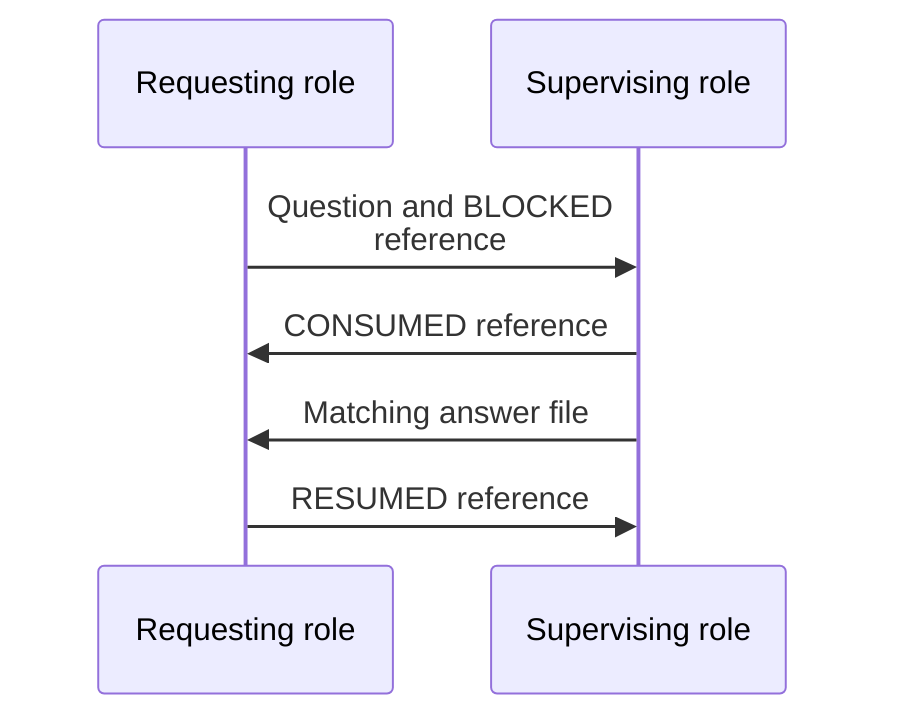

# Protocol contracts

## Story: Supply facts the dashboard can check

As an integrator, I make my factory's records understandable to the dashboard without exposing how its workers think or run. The dashboard shows the resulting work graph, identifies broken expectations with evidence, and gives the operator a repair prompt. When the records cannot support a conclusion, it says what is missing.

The protocol's language and meanings belong to the public project. Locations, concrete worker bindings and credentials belong to each installation. The reader profile below is a design requirement for the local-source ticket, not a claim that its parser exists. The current browser decoder implements `factory-graph/1` for synthetic graph documents; the full obligation/claim representation remains to be specified and implemented.

## The contracts at each boundary

| Contract | Producer and consumer | Public meaning | Current status |
| --- | --- | --- | --- |
| GitHub work | GitHub to the private read service | GitHub repositories, issues, milestones, pull requests and source relationships; scoped repository identities | Real-source adapter pending |
| Factory communication files | Factory producers to the private read service | Role runs, journal events, activity claims, questions, answers, notes and exact acknowledgements | Supported reader profile and byte-level version marker pending |
| Graph and findings | Private read service to the authorised browser | Approved work/role facts, typed relationships, coverage, findings and repair prompts | `factory-graph/1` graph decoder implemented for examples; protocol facts/findings snapshot extension pending |
| Manual repair handoff | Browser to operator clipboard, then operator to a worker | A deterministic problem description with evidence, candidate recipient and green condition | Copy and manual-copy fallback implemented for current graph findings |
| Dashboard-to-worker delivery | A future dashboard writer to configured local channels | Delivery, correlation, acknowledgements and replies under explicit write authority | Deferred until the read-only release is accepted |

No contract exposes an AI-provider API or worker launcher. A browser graph identity is not a path or an executable address. The [system boundaries](system-boundaries.md) define the capabilities these contracts may use.

## Factory communication vocabulary

The initial supported reader profile should recognise the following existing forms. A versioned parser specification and synthetic fixtures must bind their exact encodings before real input is enabled. Unsupported role-specific tags remain unsupported; arbitrary prose does not become a protocol event.

| Record | Meaning and required correlation | Interpretation limits |
| --- | --- | --- |
| `STATUS.md` | Append-only events of the form `<UTC timestamp>  <TAG>  <one-line message>`; two-space separators. Source/run identity and immutable revision locate each event. | Journal growth and timestamps do not prove progress, presence or global event order. |
| `START` | An assignment/run has acknowledged its brief; public role and work association are recorded or explicitly bound. | Does not prove a current working claim. |
| `BLOCKED` | A blocked assignment names the question or obligation causing it. | Does not identify a debtor unless a corresponding relationship is recorded. |
| `RESUMED` | The role records application of a named answer to the matching question. | An unrelated answer or earlier-run identifier cannot resolve the blocker. |
| `CONSUMED` | A supervisor records receipt of a named child event. | Receipt is distinct from forwarding, answering, acceptance and resolution. A line number alone is insufficient without its source revision. |
| `NOTE` | A durable note, or an exact acknowledgement of a named inbox note where the profile declares that form. | Does not resume a paused assignment or acknowledge unrelated instructions. |
| `COMPLETE` | A run ends and hands control back; outcome and remaining obligations are retained. | Does not imply success, acceptance, merge or release. |
| `PAUSED` / `PARKED` | Intentional inactivity with authority, reference and wake/resume condition. | A later informational note does not silently end the pause. |
| `LIVENESS` | A `WORKING` or `WAITING` claim with claim time and lease, or an explicit pause claim. Private process fields are excluded from browser output. | Lease freshness is computed from injected observation time. `WAITING` can mean listening on channels; it is not automatically a blocking dependency. |
| `questions/Q-NNN-<slug>.md` | Context, decision needed, options and recommendation; scoped to its source and run, with a recorded intended recipient. | A filename number is not globally unique. Raw question prose is not automatically browser-approved. |
| `answers/A-NNN-<slug>.md` | A recorded answer bound to the exact question, run and applicable revision. | Delivery does not prove receipt, application or resolution. |
| `inbox/NOTE-NNN-<slug>.md` | A supervisor's note with its identity, applicability and acknowledgement requirement. | The dashboard observes it; it never delivers or acknowledges it. |
| Handoff or retirement record | The ended assignment, outstanding obligations and accountable successor/disposition where required. | Retirement and acceptance remain separate. No folder move or parent retirement silently retires descendants. |

GitHub state stays distinct from these records. A closed ticket does not by itself settle a question; a journal gate pass does not establish hosted CI or release. Review events need candidate and gate identity before they can support readiness. The initial supported review-event subset must be enumerated with the same precision as the core profile.

Private raw forms may contain process IDs, command hashes, paths or launcher details. A parser may need to recognise their syntax to read an existing claim, but those values do not enter the public graph or prompts. Process files and process verification are outside the first-release input boundary.

## A question has several separate facts

The arrows describe logical file-backed exchange, not dashboard delivery or direct pane messages. The question lives in the requesting role's configured channel. The supervisor's consumption is a fact in its own journal; the answer is a separate file in the requester's channel. The requesting role records application separately. An adapter may derive these edges only from exact references and declared ownership, not directory nesting alone.

An escalation retains the original question identity and adds the new responsible recipient. A handoff retains unfinished obligations and records their accountable successor. If the applicable profile cannot represent a permitted disposition, that is a protocol gap to resolve before accepting the corresponding invariant—not a checker exception or a fabricated answer.

## Required fact identity and observation coverage

Every fact used by a check must identify its configured source, public role run or work scope, record/event identity, immutable source revision or content identity, and observation time. Preserve event time when available; report invalid or missing time rather than inventing it. Public identities are opaque and must not encode private paths, provider names or session identifiers.

Relationships distinguish work membership, responsibility, supervision, blocking obligation, question, answer, acknowledgement, review and acceptance. `factory-graph/1` currently represents only membership, role attachment and recorded communication. Its communication edges cannot be reinterpreted as blocking waits. Adding obligations requires an explicit versioned representation and decoder tests.

The observation reports which configured sources and record ranges were covered, their cursors/revisions, last successful reads and any failures or truncation. Exact correlation includes source, run, obligation and applicable revision. Policy allowances account for separately sampled sources; timestamp proximity alone cannot establish identity, authority or causal order.

| Input condition | Required outcome |
| --- | --- |
| Unknown protocol version or invalid required configuration | Refuse that source's activation with a redacted reason. |
| Malformed, oversized or replaced/truncated input | Report the defined refusal/coverage gap; never turn lost evidence into success. |
| Unknown event or missing required correlation | Preserve unsupported/unknown coverage; it cannot satisfy or clear a rule. |
| Duplicate event at the same identity and revision | Process once; repetition does not create a second obligation. |
| Conflicting facts or changed source revision | Retain the conflict or supersession lineage; do not select authority by the latest timestamp alone. |
| Unavailable source after a finding | Retain the prior finding with degraded observation quality; do not declare it resolved. |

## The finding and repair-prompt contract

Every supported check returns **supported**, **violated**, **unknown**, or **not applicable** for its declared scope. It states the required facts and coverage, the rule/policy version, its observed evidence, and its legal green condition. A broken claim, overdue obligation and observation gap are different findings.

A finding also carries affected graph identities and a candidate recipient derived from recorded responsibility/supervision with sufficient declared authority. If no recipient can be established, say so and route investigation to the installation operator; do not guess a worker from a label. Process presence and permission to act are separate facts.

The repair prompt carries the problem, scoped evidence references, observation limits, recipient, a request within that role's authority, and the exact condition that a later observation must satisfy. It must not propose writing a fake acknowledgement, deleting history or changing a status merely to remove a warning. Copying, acknowledgement, answer delivery and actual resolution remain separate.

The [invariant catalog](invariant-catalog.md) defines the intended rules and control cases. Its question/wait/claim rules cannot run on the current synthetic graph because those facts are absent. Reference and observation-gap checks already run; that is not evidence of full factory diagnosis.

## Compatibility and conformance

Before freezing the initial reader version, publish its version marker, exact grammar for each supported file/event, field types, identity rules, limits, refusal behavior and public projection. Do the same for the configuration and graph/findings snapshot. A prose vocabulary is not a parser contract.

Conformance fixtures must demonstrate a full matching question/answer/application exchange; unrelated and reused question numbers; an intentional pause; fresh and expired claims; a legitimate channel listener; a blocking chain with an external wake source; a genuine exclusive wait cycle; handoff with unfinished work; source truncation; and denied private fields. Include positive and negative cases for each rule so missing or unrelated evidence cannot clear it.

A second factory must produce compatible records using different roots and worker implementations without changing the dashboard. It may use the suggested worker skill, its own scripts, or another implementation of the same protocol. Producer setup and skill installation stay outside the dashboard.

Versioned changes must state which readers/producers remain compatible. Never silently reinterpret a known tag, overload an identifier or infer an extension from free text. Acceptance of these contracts precedes real-source activation and first-release approval.
