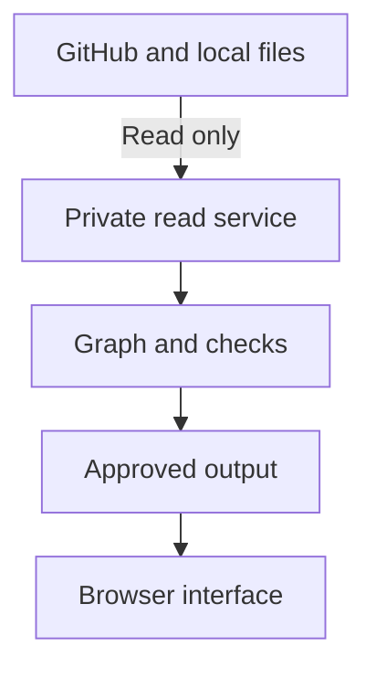
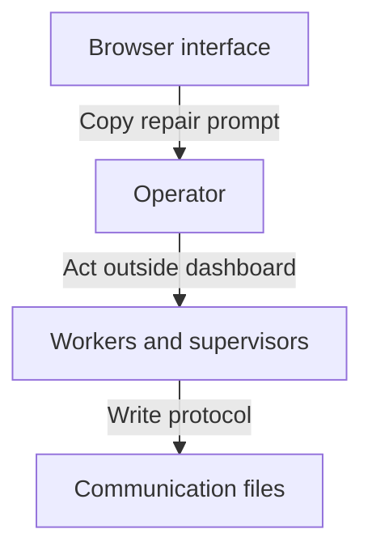

# System boundaries

## Story: Use the same dashboard in another factory

As a factory operator, I run the published dashboard against my own GitHub repositories and local communication files. I change configuration, not application code. I can see what the dashboard reads, what it exposes, what it cannot check, and what remains my responsibility.

These are first-release requirements. The current app implements a synthetic graph and limited checks; real configuration, source readers and full protocol checks are not implemented. This page defines their boundary before integration. The [configuration contract](configuration.md) and [protocol contracts](protocols.md) supply the accompanying detail.

## The product and its environment

The first release has one observation path. Private configuration limits the repositories, files and access available to the read service.

Only the operator crosses the action boundary. Workers produce the records; the dashboard does not start them or write their channels.

The read arrows grant only configured access. The operator takes a repair prompt to the factory separately. That manual action is outside the dashboard's authority. All browser output passes through the approved-field boundary, including findings, summaries and prompts.

| Boundary | Dashboard owns | Installation or factory owns |
| --- | --- | --- |
| Work source | Read configured GitHub records and preserve source identity | Repositories, permissions, credentials and GitHub relationships |
| Communication source | Decode the supported public file protocol | Producing compatible records and keeping the files available |
| Coordination | Interpret recorded roles, supervision, assignments and obligations | Real worker bindings, staffing, decisions and execution |
| Diagnosis | Evaluate rules against observed facts; retain unknowns and evidence | Supplying enough facts to make a rule evaluable |
| Resolution | Prepare a prompt and re-check later observations | Delivering the prompt, authorising action and recording its outcome |
| Access | Refuse unsafe activation and enforce the approved output contract | Selecting viewer access and supplying the supported access mechanism |
| Secrets | Resolve server-side references; omit private values from output | Storing and rotating credentials outside public artifacts |

## What is fixed and what is configured

The product fixes the protocol's meanings, supported versions, decoding rules, graph identities and relationship types, invariant semantics, and the permitted operations. GitHub's existing vocabulary is preserved. An installation cannot redefine an acknowledgement to mean an answer, or make an expired activity claim fresh by changing its display label.

Configuration supplies repository allowlists, source roots and permitted files, protocol profile, public role labels, private role-to-worker bindings, serving/access settings and secret references. Observation allowances and policy deadlines may be configured within documented validation rules; they are reported with findings and never silently change a structural invariant's meaning. No rule derives supervision, authority or a blocking wait from a folder name or a role label.

A role is a visible responsibility. Its implementation is outside the product: model/provider selection, system prompts, launch commands, worker processes and private identity. Public repair-prompt templates are dashboard output; they are distinct from those private worker prompts.

## First-release capabilities

The runtime may read only configured GitHub resources and configured local communication/status files. Its only external application traffic is GitHub read access. Browser traffic stays with its own dashboard origin; bundled assets require no CDN, telemetry or model service. Build-time dependency downloads are a separate installation activity.

There is no worker-control or source-write endpoint. The dashboard cannot send questions or answers, acknowledge a message, launch or interrupt a process, change GitHub, discover tmux panes, inspect `/proc`, scan a home directory, or repair a factory's setup. A claim in a file is evidence of a claim, not independent process verification.

Dashboard-owned cache and redacted diagnostics may use a separate configured storage location. They must not alter source files or manufacture factory events. Browser theme storage and an operator-triggered clipboard copy are UI effects; neither changes the factory.

Unsupported or malformed input is refused or marked unavailable at its defined source/record boundary. Stale or missing input remains an observation gap. An incomplete branch cannot pass an invariant because its records disappeared. The evaluator needs typed obligations and sufficient coverage before diagnosing a deadlock or recommending a responsible recipient.

## Internal responsibilities

| Component | Responsibility | Must not do |
| --- | --- | --- |
| Configuration and access | Validate versions, capabilities, roots, repository scope and secret references before activation | Pass private configuration to the browser |
| Source adapters | Bounded read operations, parsing, source revisions and observation quality | Execute input text, infer missing events or write sources |
| Domain graph | Scoped identities, work membership, responsibility, supervision and typed obligations | Perform network, filesystem or credential operations |
| Invariant evaluator | Deterministic outcomes from a snapshot, explicit observation time and policy | Guess from pane activity, role names or unrelated messages |
| Projection and prompt generation | Approved structured output, evidence references and manual repair prompts | Include raw journals, private paths or worker implementations |
| UI | Graph exploration, evidence inspection and copying | Acquire source credentials or gain direct filesystem/worker access |

These are code responsibility boundaries, not a requirement for microservices. One private read service and one browser app are enough. The pure domain/evaluation core must be testable without a live machine.

## Decisions

| Chosen boundary | Alternative excluded | Reason |
| --- | --- | --- |
| Public protocol; private worker implementation | Depend on one launcher, model or machine | Another factory must work without copying our intelligence or host setup. |
| Configured file reads | Process discovery or machine repair | Keep access explicit and the product small. |
| Recorded obligations | Guess waits from communication or simultaneous WAITING states | The graph must explain broken expectations from facts. |
| Manual repair prompt before interaction | Dashboard writes or worker control in the first release | Observation and evidence must be reliable before adding authority. |
| Projection before browser serialisation | Hide private fields visually | Hidden UI fields are still disclosed if sent to the client. |

## Portability and release proof

Two synthetic factories must run the same built artifact, with different repositories, file roots, public role labels and private bindings. Only their configuration and producer records change. Neither installation's identity may be compiled into the application.

Release evidence must prove permitted reads, denied writes, denied out-of-scope paths and destinations, approved-field output, secret exclusion, unavailable-source behavior and invariant negative controls. Every supported rule needs a legal recorded change that can make it green. A missing observation is not that change. Actual access and configuration enforcement are release gates, not properties supplied by this document.

The later [communication milestone](roadmap.md#milestone-communicate-back-through-the-graph) will introduce a separately authorised local write boundary. Team operation comes after that. Neither is implied by a current graph edge, prompt or protocol document.
